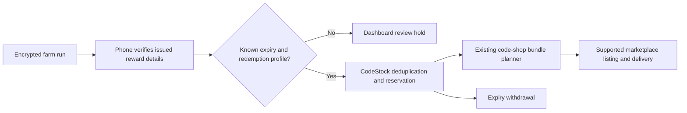

# TikTok code stock

TikTok feeds the existing code shop, which owns allocation, offers, delivery,
expiry withdrawal and after-sale accounting. It does not create another seller
or duplicate the marketplace delivery paths.

## Contract

- A completed farm run remains the encrypted source. Its identity in CodeStock
  is `tiktok:<account>` / `run-<run id>`. Campaign and task IDs define the slot,
  independently of acquisition order or identical display names.
- The Android worker reads the native reward detail while idle. It matches the
  issued code's SHA-256 fingerprint to the already stored run before reporting
  metadata. Neither the check nor the dashboard redeems a code.
- `gift.end_time` supplies redemption expiry. Campaign `end_time` and
  `claim_expire_ts` are not substitutes. Unknown dates never enter saleable stock.
- Game, reward, quantities, redemption method and dates are validated. Known
  game profiles pin redemption routes; unknown games remain review holds.
  World of Tanks PC EU is separate from Blitz, Console and other regions.
- A metadata refresh preserves the claim timestamp and cannot change the
  identity of a verified reward. A changed identity blocks the source and
  withdraws its unsold units on the next shop cycle; sold units are preserved.
  Read failures preserve verified expiry; retries
  are hourly, with successful refreshes every six hours.
- Native reward artwork is carried with the metadata. Covers resolve the latest
  verified image URL when rendered, since CDN image links have their own expiry.
  Only the reward CDN is accepted; missing artwork blocks publication.
- Source import defaults off for a staged deployment. Enable
  `sources.tiktok` after checking metadata and a draft/delivery rehearsal.
  Existing code-shop autoPublish, permitted markets and pricing apply. Initial
  default is the existing $1 Eldorado bundle price; PA remains per-game gated.
  No Gameflip, Plati, GGSel or new marketplace adapter is enabled.
- The existing 36-hour expiry guard removes stock before use-by; code reads for
  building/replacing TikTok units additionally refuse codes inside that buffer.
  Bundles use the earliest expiry, and descriptions include the deadline and
  once-per-event-reward restriction. A source name never enters buyer text.
- Farm-panel reveals hold free codes. Allocated/sold codes cannot be revealed
  there. An explicit Code shop held-release action is required after a reveal.
- New supported events are imported automatically. Existing planner readiness
  (event end plus grace, 24-hour collection stall or expiry window) applies;
  this avoids creating incomplete bundles while rewards are still arriving.

## Data flow

The Sales tab exposes products, listing links, stock states and review reasons.
The shared Code shop retains price, pause, retirement and held-release controls.
The design deliberately keeps farm failure and listing failure independent.
At larger scale, paginate metadata reads and review rows before expanding the
current bounded worker fleet; do not add parallel marketplace publishers.
