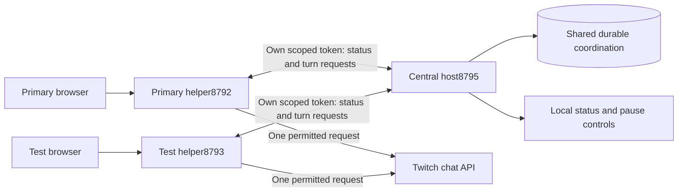

# ADR-001: One local coordination authority

**Status:** Accepted and implemented
**Date:** 2026-11-25 (Asia/Tokyo)

**Amendment:** [ADR-002](ADR-002-bounded-exchanges.md) adds the owner's subsequent request for occasional bounded public exchanges; the [2026-11-26 message format amendment](EXCHANGE-FORMAT-1126.md) removes the inline prefix. Ordinary companion messages still do not trigger each other.

**Account-control amendment:** [LOCAL-PAGES.md](LOCAL-PAGES.md) adds per-account local pages. Their separate adapter reads existing helper pairings in server memory and exposes sanitized public chat/history; the coordination store and internal turn protocol retain their original narrow data boundary.

## Context

Two independently authenticated personal companions could post the same greeting and category question. A shared SQLite duplicate ledger fixed wording and opportunity collisions, but each helper still chose when to post independently. The owner requested a middle host that lets the companions coordinate better.

## Decision

Run a dedicated loopback service on8795 as the single coordination authority. Preserve each helper's OAuth, browser connection, account settings and provider-send boundary. Reuse and migrate the existing duplicate database so already-published broadcast questions stay consumed. Communicate internal presence and proposals rather than creating public automated conversations between the accounts.

The shared channel budget is six actual attempts/hour with at least three minutes between them. Per-account ten-minute participation spacing stays in place. Fresh queued direct replies have priority; equally eligible clients rotate away from the last speaker. Quiet rooms stay quiet rather than inventing exchanges.

## Alternatives considered

| Option | Benefits | Costs |
| --- | --- | --- |
| Keep helper-side SQLite only | Few components, atomic text deduplication | No common turn-taking, channel budget or reason/status view |
| Dedicated local coordinator | One authority, durable outcomes, visible control, no new paid service | New local service and scoped client pairing; host outage holds sends |
| Cloud coordinator | Independent of the Mac for host uptime | Hosting/TLS/remote credential management and ongoing cost; browser/video still depend on Mac |

Local coordination fits the two existing profiles and introduces no cloud bill or remote exposure. Revisit remote hosting if the owner explicitly moves browser workers onto always-on machines.

## Delivery boundary and recovery

A reservation is a20-second unused lease. A separate single-use begin transaction records a submitting attempt before authorizing Twitch. Unused leases can expire; submitting/unknown content ownership cannot expire into another send grant. Distinct future conversation can proceed after the shared spacing even if an older result is uncertain. A helper that knows it never invoked Twitch can certify cancellation, including after a lost begin response. Confirmed and rejected delivery are monotonic under outbox replay.

Each helper durably records provider results and completion outbox locally. A host outage after Twitch confirmation does not relabel that known confirmation unknown. Reconnection replays outcomes and reconciles own history by coordinationId. The coordination protocol never receives raw incoming message bodies, Twitch credentials, helper pairing secrets or cookies; the separate local account-page adapter has the explicit scope described above.

## Limits

This service coordinates these local personal companions. It does not operate browser video while the Mac sleeps, interpret video/audio, remove Twitch phone/follower restrictions, or change account verification. Existing intermittent background playback readings remain a separate browser-observation issue. Host/API tests and sampled live checks do not prove uninterrupted overnight playback.
