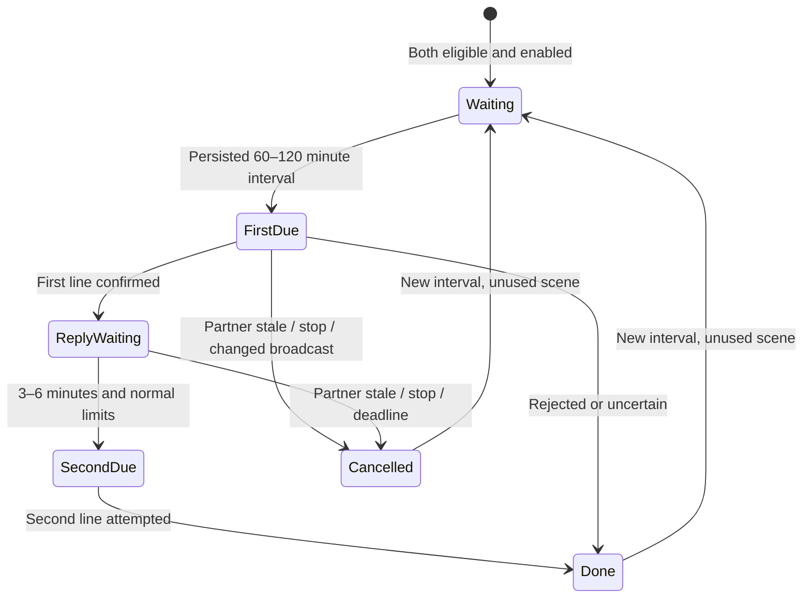

# ADR-002: Bounded companion exchanges

**Status:** Accepted and implemented
**Date:** 2026-11-25 (Asia/Tokyo)

**Message format amended:** 2026-11-26 at the owner's request; see [EXCHANGE-FORMAT-1126.md](EXCHANGE-FORMAT-1126.md).

## Context and decision

The owner requested occasional exchanges among up to three personal companions, with varied wording and pauses. Keep the existing ban on unbounded companion-triggered reply chains. The host schedules a single scene with exactly two possible lines. Each public line uses `@recipient scene text`, with the selected partner's exact handle; profile metadata and account identity remain unchanged.

Both selected clients must independently report current playback and participation metadata for the same live broadcast. The host persists one schedule per channel, rotates eligible pairs by least-recent use, alternates speakers, draws from unused local scenes, and grants the existing single-use send permits. Each active pair is bound to its persisted two exchange lines; an unrelated third does not replace either participant. Human conversation keeps priority. A confirmed first line can unlock only its predetermined second line; uncertainty, rejection, stale identity or leaving the stream ends the scene.

The host stores scene identifiers, timestamps and outcomes rather than incoming chat text. Content is local and bounded; it does not require model generation or new credentials. Existing Twitch inspections and shared budgets apply at the provider boundary. No live fast-forward or demonstration send is introduced.

## Tradeoffs

Curated scenes give predictable boundaries and exact-text validation, with a finite supply. When all scenes have been used in a channel, the feature stops until new scenes are added. Slow intervals keep this secondary to the stream's conversation. Requiring both profiles to stay fresh means a browser observation interruption can cancel an exchange, which is preferable to continuing alone or replaying old lines after recovery.

Revisit scene authoring if the owner wants a larger collection. Revisit hosting only if the browser workers move to an always-on machine; this feature does not keep a sleeping Mac online.
