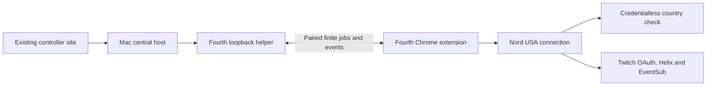

# Fourth personal companion — rollout contract

Owner request 2026-11-26: create the fourth profile with the same full Twitch setup and add the official NordVPN Chrome extension to that profile. The existing three personal companions remain inactive during preparation. This does not authorize chat automation from the account farm or reuse of sold, connected, reserved or previously used inventory.

The new fixed identity is `fourth`, project `stream-companion-fourth`, Chrome profile **Stream Companion Fourth**, helper loopback **8797**, and LaunchAgent `local.stream-companion.fourth-helper`. Port 8797 was verified unused before preparation. Generate a fresh extension identity, pairing/client tokens and held journals; do not clone private state, browser storage, OAuth grants or history. Allocate at most one pristine owned account using the established full eligibility, managed-home, live inventory and atomic reservation proof. A lost allocation outcome requires reconciliation of that same intent, never another pick.

## Roster and migration

The supported roster becomes exactly `primary,test,third,fourth`. `both` continues to mean the original primary/test pair. Quick Start adds fourth alone and All four. Existing channel/account limits, exact plans, generations, human priority, duplicate suppression, partner identity, single-use permits and uncertain-delivery no-retry behavior do not change.

Upgrade the existing persisted bank transactionally and once. Keep every old immutable revision. Append fourth's profile with mentions/local defaults and no activation. Preserve existing profile preferences, group IDs, wording, order, enabled values and every selective account assignment. To give the new companion the shared wording requested by “same full setup,” append fourth only to groups whose assignments were exactly all three old profiles; selective subsets remain exact. Fresh defaults cover the four profiles. Persist the migration as a new revision and make restart idempotent. Never seed a new default bank over the live revision-5 bank. Preserve the existing 22 history rows, consumed opportunities, imports, permits, outboxes and scene identities/consumption.

Keep the existing three helpers unchanged unless a verified compatibility defect requires a targeted fix. Their protocol already accepts a dynamic account roster. Update host account sources, exchange roster validation, browser mapping, clip account set, background logger, history filters and finite routes. Browser mappings retain two/three-profile compatibility, permit the fourth only with a distinct verified directory, and never infer another profile's directory.

## UI and protected routes

Accounts, Messages, Shared coordination and the ordinary site navigation remain connected. Extend both account-page matchers and per-account start generation state. Show four cards/settings in a two-by-two desktop arrangement and one column on phones. Bank validation and filters cover exactly four profiles. Account details use the same central history and preferences as the Messages page.

Clips support all 15 nonempty finite creator subsets. Preserve the old primary/test/third selection through its own explicit selector key when All becomes four. Do not add fourth to existing clip settings, enable automatic clips, create a clip or request new grants implicitly.

Mac and cloud gateway exact route/body allowlists must agree on fourth account/detail/browser/command/history paths and four-profile bank/clip validation. Preserve superadmin/two-factor authentication, Origin/CSRF, request/response limits, credential redaction and no mutation retries. No arbitrary proxy, URL, executable, country selector or VPN endpoint is added.

## Preparation, access and activation

Finish the isolated browser, account, email handoff, explicit app approvals and new helper preparation before the coordinated roster cutover. Fourth imports require a registered client; registering it briefly holds central readiness until both new authenticated helper/browser imports are durably acknowledged. Perform registration and additive bank upgrade under global Pause with all profiles inactive. Restore the prior shared feature settings only after all eight imports and installed loaders are verified. No session Start, public message, follow or clip is required to prove the migration. Any necessary new Twitch or extension grants follow the action-time browser permission process. Recovery email/password changes remain owner-operated.

The owner approved the actual NordVPN Web Store permission prompt. Install only the official extension `fjoaledfpmneenckfbpdfhkmimnjocfa` in the fourth profile. Optional analytics remain off. Installing it does not prove a Nord Account is signed in or a VPN tunnel is connected. The Chrome extension covers browser traffic; the Node helper's Helix/EventSub connection is separate. Do not apply a system-wide VPN or change routing for the original three profiles. Report these states accurately.

## Owner update: USA-only routing

After native email verification, the owner required USA IPs only for this fourth account. Browser routing is verified separately: Nord Seattle/United States, preferred country US, auto-connect country explicitly US, kill switch and WebRTC leak protection on, credentialless browser country check US. The native fourth Chrome directory is Profile 6. No Twitch exclusion is configured.

The owner approved private Nord service-credential retrieval, but Nord required a code at the friend's email that the owner cannot access. Do not bypass that verification or create a token. The selected implementation uses the existing signed-in Nord extension: fourth helper HTTPS and EventSub traffic relays through its paired fourth Chrome extension's background network context. No Nord service credential is required or stored. Original three helpers, global/system routes and direct loopback central-host/mail traffic remain unchanged.

The helper has no direct Twitch fetch/WebSocket fallback. A short-lived authenticated, account-bound browser relay session transports only finite Twitch OAuth/Helix/EventSub operations. Browser permission is optional and explicit for fixed Twitch and credentialless Cloudflare country-check origins. Every outbound HTTP/WebSocket open requires fresh strict US attestation in that same browser context followed by a single-use helper begin check against the current control/session generation. Missing permission, absent/stale browser, connection failure or unknown/non-US country blocks work and closes relay sockets. Lost responses remain uncertain and never repeat a mutation. Token-bearing bodies and events stay in bounded memory; no browser storage, logs, URLs or UI may retain them. Preserve single-use permits, Stop and exact-text send checks across the relay boundary.

Trade-off: fourth network access now depends on that Chrome profile being open and its relay lease remaining healthy, including during authorization. The existing launcher can reopen it; it may not substitute another profile or bypass the route while waiting. The extra local and country-check round trips trade latency for explicit USA gating. Keep this transport account-local if more profiles are added; do not turn it into an arbitrary browser proxy.

Keep the fourth helper held while testing the route and completing its explicit Twitch grants. Verify native browser US routing and real paired browser attestation; a successful localhost health check alone proves neither. Only then continue the coordinated eight-import registration cutover. Cold-open testing must confirm the same fourth profile and USA route return without starting automatic chat.

## Verification and recovery

Test existing-bank upgrade/restart/CAS and selective assignments, eight-source readiness, no old greeting/history/scene replay, fixed route rejection, separate port/manifest/pairing identity, exact roundtrips for all clip subsets, four-account startup/Stop and held unselected accounts, dynamic peer-message exclusion and existing pair bindings. Use disposable public-source stages with no real Twitch sends.

Fingerprint intended installed files before overwriting, back them up and verify new fingerprints. Preserve unrelated dirty work and all private config/history. Push deployed source and refresh Graphify/Studio for the resulting commit. Rollback is coordinated source-only while all profiles/global coordination are held; never restore old SQLite, account allocations, credentials or delivery journals, or silently resume an autonomous planner. Once the four-profile bank is persisted, the old three-profile host/gateway is not a compatible rollback target. Keep a four-profile-aware host/gateway and stop the fourth helper if the USA transport needs repair; never restore the old direct-network fourth helper under the USA-only rule.
